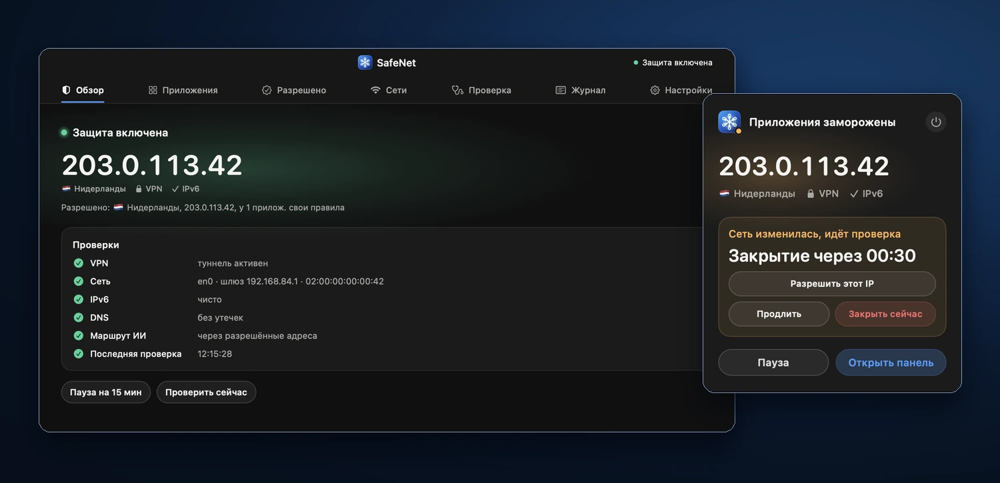
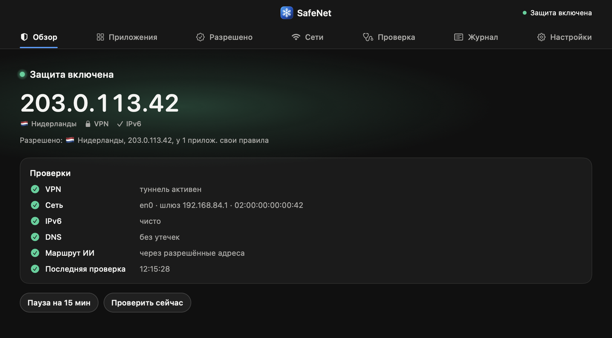
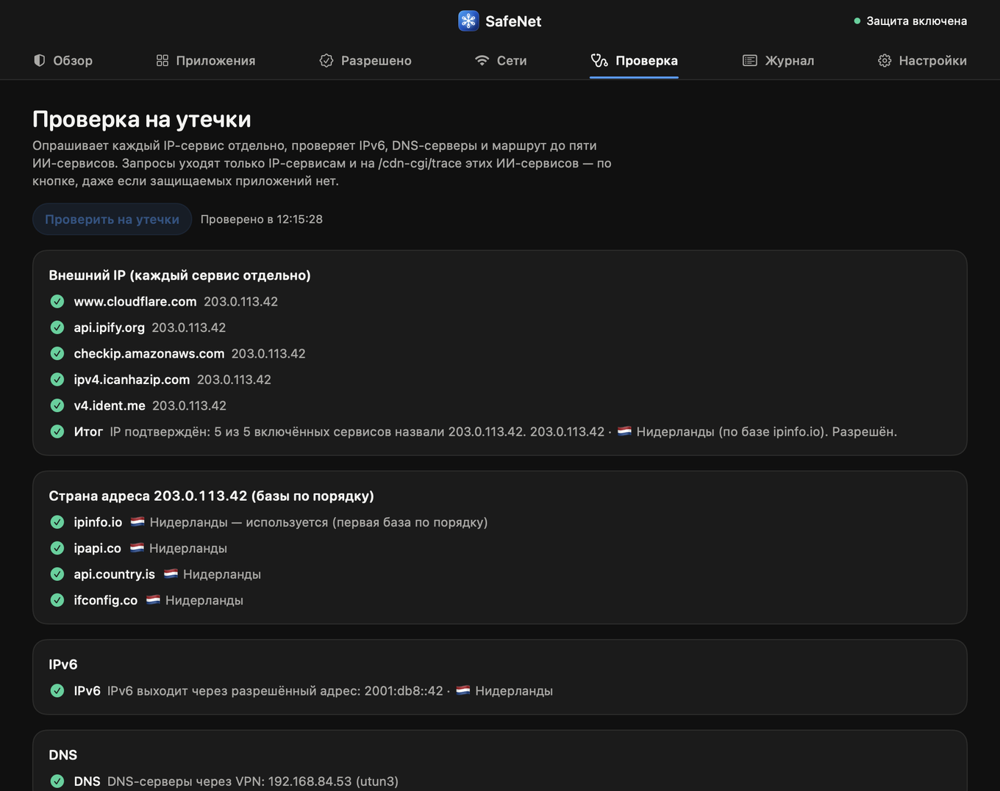
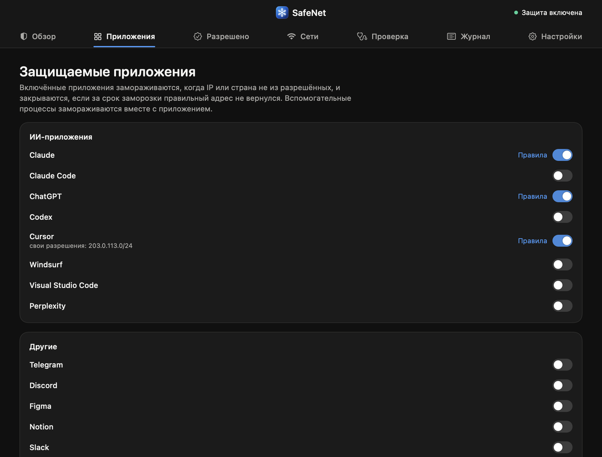
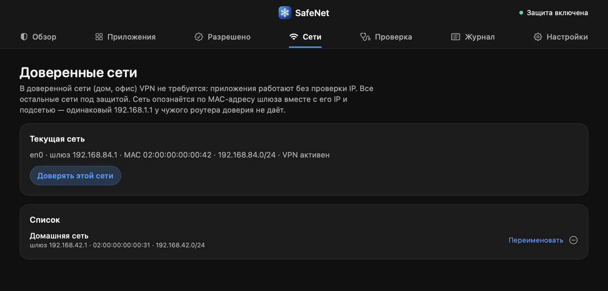
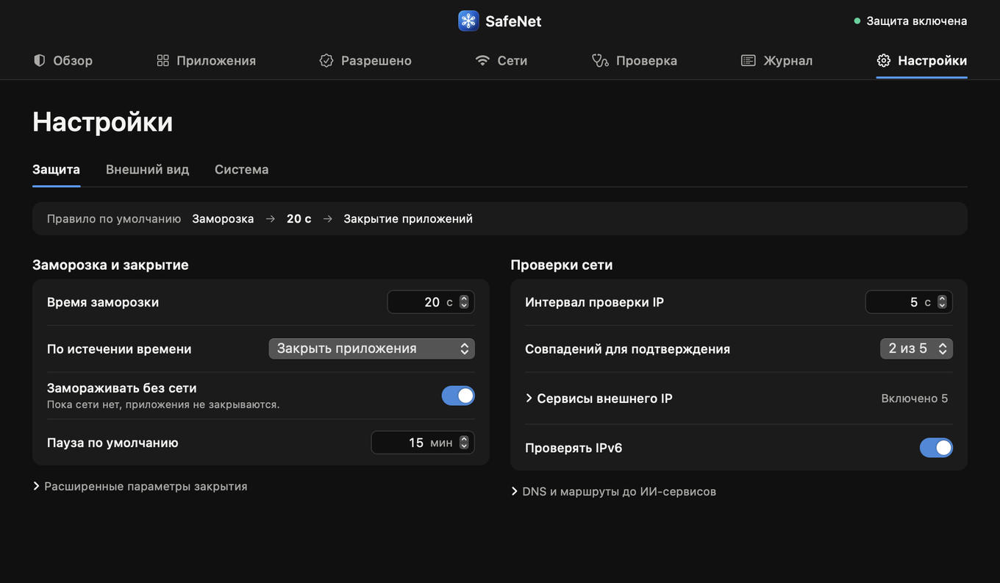
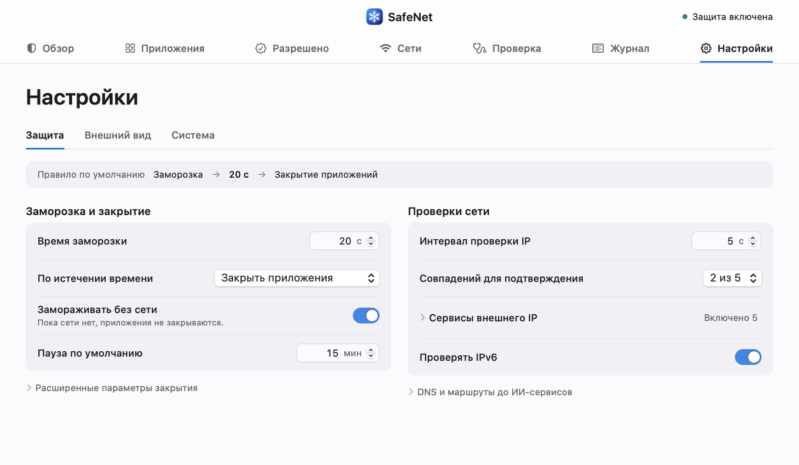
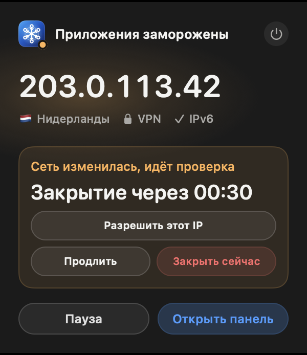

  

<h1 align="center">SafeNet</h1>

<strong>Kill switch для выбранных приложений на Mac</strong>

Когда VPN отключается или внешний IP перестаёт подходить под ваши правила, SafeNet ставит выбранные приложения на паузу. Они продолжают работу, когда проверка снова проходит.

  <strong><a href="https://github.com/orleony/safenet/releases/latest">↓ Скачать для macOS</a></strong>
  · macOS 13 и новее · Intel и Apple Silicon

  <a href="#установка">Установка</a> ·
  <a href="#что-происходит-при-смене-сети">Как работает</a> ·
  <a href="#настройка">Настройка</a> ·
  <a href="#скриншоты">Скриншоты</a> ·
  <a href="#частые-вопросы">Вопросы</a>

  

## Что происходит при смене сети

Допустим, Mac переключился с Wi-Fi на точку доступа, а Claude и Cursor были под защитой. Вот что покажет SafeNet.

| Событие | Что происходит |
| --- | --- |
| Сеть изменилась | SafeNet ставит приложения на паузу и начинает проверку. В строке меню видно причину и, когда действует таймер, сколько осталось до закрытия. |
| VPN переподключился | Если IP снова разрешён и проверки пройдены, приложения продолжают работу с того же места. |
| Разрешённый IP так и не вернулся | По истечении заданного времени SafeNet закрывает приложение, держит его на паузе или возобновляет. Действие задаётся в «Настройках». |

SafeNet реагирует на события macOS и регулярно сверяет внешний адрес. Если адрес меняется без системного события, обнаружение зависит от очередной проверки. До обнаружения приложения могут успеть отправить трафик. Для блокировки на уровне сети используйте kill switch самого VPN.

## Установка

**[Скачать](https://github.com/orleony/safenet/releases/latest)** · [История релизов](https://github.com/orleony/safenet/releases)

Архив содержит готовый `SafeNet.app` для Intel и Apple Silicon и текстовую инструкцию.

1. В разделе **Assets** скачайте `SafeNet-<версия>.zip` и распакуйте его.
2. Перетащите `SafeNet.app` в «Программы» и откройте. SafeNet подписан ad hoc, без нотаризации Apple. Если macOS заблокирует первый запуск, разовое подтверждение доступно в «Системные настройки» → «Конфиденциальность и безопасность» → «Всё равно открыть». [Справка Apple](https://support.apple.com/en-us/102445)
3. Нажмите значок SafeNet в строке меню и выберите «Открыть панель».

## Настройка

### Задайте, какую сеть считать подходящей

1. Включите VPN и зайдите в «Разрешено». Добавьте его внешний IP, подсеть или страну. Если VPN часто меняет сервер в одной стране, правило по стране позволяет обойтись без обновления каждого IP.
2. Откройте «Приложения» и включите защиту для нужных программ. В списке уже есть Claude, Claude Code, ChatGPT, Codex, Cursor, Telegram и другие. Свою программу можно добавить по имени процесса или пути.
3. Откройте «Правила» рядом с приложением, если ему нужны отдельные разрешения. Например, Claude можно разрешить только выход из Нидерландов, а Cursor — из Нидерландов и Германии. Список приложения заменяет общий. Здесь же можно задать отдельное время заморозки.

Во вкладке «Сети» можно сохранить проверенную домашнюю или офисную сеть как доверенную. SafeNet сверяет данные шлюза и подсети, чтобы распознать её при подключении.

### Выберите, что делать при заморозке

Откройте **Настройки → Защита**, чтобы задать время ожидания, действие по таймеру и поведение без интернета. Приложения, замороженные из-за отсутствия сети, остаются на паузе без отсчёта до закрытия. При восстановлении связи SafeNet проверит новый адрес.

Во время заморозки можно продлить ожидание или закрыть приложения прямо из меню. Для временного отключения защиты есть «Пауза» на выбранное время или до перезапуска SafeNet.

### Настройте интерфейс и запуск

SafeNet может следовать теме macOS или использовать выбранную светлую либо тёмную тему. Настраиваются цвет акцента, плотность интерфейса и вид строки меню. При демонстрации экрана можно оставить там только значок или страну. В журнале время отображается в системном или выбранном часовом поясе. Автозапуск при входе включается в настройках.

## Диагностика сети

Откройте «Проверка» и нажмите «Проверить на утечки». SafeNet покажет ответы каждого сервиса внешнего IP, результаты геолокации, проверку DNS и IPv6 и адреса, которые видят поддерживаемые ИИ-сервисы. Проверку можно запустить без списка защищаемых программ.

Если IP-сервисы видят разные адреса, часть запросов может идти по другому маршруту. Для Claude, ChatGPT, Codex и Perplexity SafeNet дополнительно проверяет маршрут к серверам самих сервисов. Если VPN работает через системный прокси, некоторые программы могут обходить его. SafeNet показывает предупреждение, когда видит такой прокси.

В «Журнале» можно найти причину заморозки, увидеть, когда программа возобновилась, и отфильтровать историю по типам событий. Там же счётчики заморозок, возобновлений после успешной проверки и закрытий.

## Скриншоты

SafeNet 1.0.7 на демонстрационных данных. Нажмите на скриншот, чтобы открыть его в полном размере.

| Обзор | Проверка на утечки |
| :---: | :---: |
|  |  |

| Приложения | Журнал событий |
| :---: | :---: |
|  |  |

Разрешённые адреса, доверенные сети, настройки и меню

| Разрешённые адреса и страны | Доверенные сети |
| :---: | :---: |
|  |  |

| Тёмная тема | Светлая тема |
| :---: | :---: |
|  |  |

  

## Частые вопросы

**Почему приложения заморозились сразу после добавления?** Проверьте список «Разрешено» и отдельные правила приложения. При пустом списке SafeNet держит выбранные программы на паузе без отсчёта до закрытия.

**Можно ли защитить Safari или отдельную вкладку?** Правила применяются к процессам целого приложения. Системные программы из `/System`, в том числе Safari и «Почта», SafeNet пропускает.

**Что делать, если провайдер проверки IP не ответил?** В «Проверке» видно, какой сервис пропустил запрос или вернул ошибку. В разделе «Защита» можно выбрать, какие IP-сервисы участвуют в проверке и сколько ответов должны совпасть. Адрес и страна определяются отдельно.

**Где лежат правила и журнал?** В `~/Library/Application Support/SafeNet/`. Настройки хранятся в `config.yaml`, события — в `events.jsonl`. SafeNet может подхватывать изменения YAML во время работы.

**Как поставить обновление?** Откройте «Настройки» → «Система», найдите «Обновления» и нажмите «Проверить сейчас». Можно получать уведомления, включить автоматическую установку или отключить проверки. Приложение проверяет подпись и контрольную сумму скачанного обновления.

## Приватность и поддержка

У SafeNet нет телеметрии. Внешние запросы используются для определения IP и страны, диагностики маршрутов поддерживаемых ИИ-сервисов и проверки обновлений через GitHub. Настройки и история остаются на Mac.

[Сообщить о проблеме](https://github.com/orleony/safenet/issues/new) · [Подробная инструкция](Resources/ПРОЧТИ-МЕНЯ.txt) · [Сборка и CLI](docs/development.md)

English quick start

SafeNet is a macOS 13+ menu-bar app that freezes selected apps when network checks fail. If the connection returns and your rules pass, those apps resume. You can choose what happens when the timer expires and set a different timeout for each app.

Download `SafeNet-<version>.zip` from the [latest release](https://github.com/orleony/safenet/releases/latest), move `SafeNet.app` to Applications, and open the panel. Add your VPN IP addresses or countries under «Разрешено» before enabling protection for apps under «Приложения». Keep your VPN’s kill switch enabled for network-level traffic blocking.

[Build and CLI documentation](docs/development.md)

