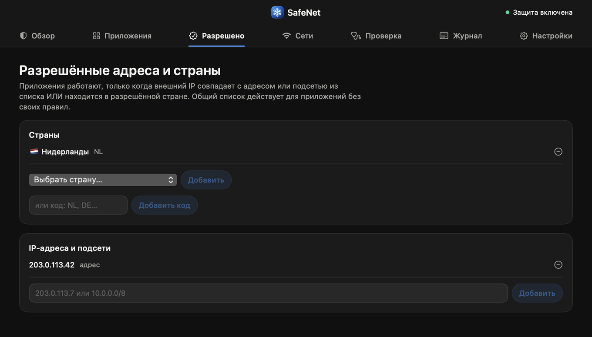
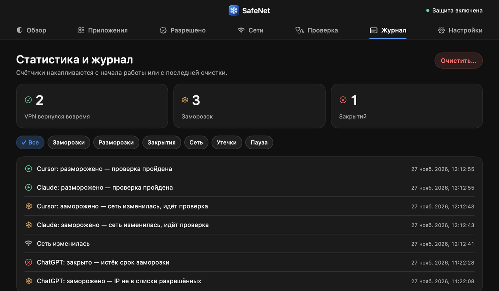

  

<h1 align="center">SafeNet</h1>

Защита приложений при смене IP или отключении VPN на macOS.

  <strong><a href="https://github.com/orleony/safenet/releases/latest">Скачать SafeNet для Mac ↓</a></strong>
  ·
  <a href="https://github.com/orleony/safenet/releases">Все версии</a>
   
  macOS 13 и новее · Intel и Apple Silicon

  

SafeNet живёт в строке меню и сверяет внешний IP и страну с вашими правилами. Если проверка не проходит, SafeNet приостанавливает выбранные приложения и возобновляет их после успешной проверки. Вы задаёте время ожидания и выбираете действие по таймеру. SafeNet может закрыть приложение, оставить его замороженным или возобновить.

## Установка и первый запуск

1. Откройте [последний релиз](https://github.com/orleony/safenet/releases/latest) и в разделе **Assets** скачайте `SafeNet-<версия>.zip`. Например, [SafeNet-1.0.7.zip](https://github.com/orleony/safenet/releases/download/v1.0.7/SafeNet-1.0.7.zip).
2. Распакуйте архив, перетащите `SafeNet.app` в «Программы» и запустите. Сборка подписана ad hoc, без нотаризации Apple. Если macOS запросит подтверждение, откройте «Системные настройки» → «Конфиденциальность и безопасность» → «Всё равно открыть». [Справка Apple](https://support.apple.com/en-us/102445)
3. Включите VPN. В меню SafeNet нажмите «Открыть панель» и добавьте разрешённые IP, подсети или страны во вкладке «Разрешено».
4. Во вкладке «Приложения» выберите, что защищать. SafeNet замораживает выбранные приложения с пустым списком разрешений и ждёт, пока вы добавите правило.

## Возможности

| Возможность | Как работает |
| --- | --- |
| **Правила для каждого приложения** | Готовые варианты для Claude, Claude Code, ChatGPT, Codex и других. Можно добавить своё приложение и задать ему отдельный список разрешений и время заморозки. |
| **Проверка сети** | Отдельное определение IP и страны, диагностика DNS и IPv6, проверка маршрутов до пяти ИИ-сервисов и признаки раздельной маршрутизации. |
| **Управление из строки меню** | Текущий IP или страна, пауза защиты, таймер заморозки и действия с приложениями. |
| **Журнал и настройки** | История событий и счётчики, доверенные сети, светлая, тёмная или системная тема, цвет акцента и часовой пояс журнала. |

## Скриншоты

Интерфейс SafeNet 1.0.7 с демонстрационными адресами и событиями.

| Приложения | Настройки защиты |
| :---: | :---: |
|  |  |

Остальные вкладки, светлая тема и меню заморозки

| Разрешённые адреса и страны | Доверенные сети |
| :---: | :---: |
|  |  |

| Результаты диагностики | Журнал событий |
| :---: | :---: |
|  |  |

| Светлая тема | Меню во время заморозки |
| :---: | :---: |
|  |  |

## Как работает защита

SafeNet приостанавливает процессы после обнаружения сетевого события или смены IP. Если внешний адрес меняется без события macOS, SafeNet узнаёт об этом при очередной проверке. До неё приложение может успеть отправить трафик. Для блокировки трафика на уровне сети оставьте включённым kill switch вашего VPN. Системные приложения из `/System`, в том числе Safari, SafeNet пропускает.

Настройки и журнал хранятся на Mac. Приложение обращается к сервисам определения IP и страны, проверяет маршруты до поддерживаемых ИИ-сервисов и загружает обновления из GitHub Releases, если они включены. Телеметрии нет.

[Подробная инструкция](Resources/ПРОЧТИ-МЕНЯ.txt) · [Сборка и CLI](docs/development.md) · [Сообщить о проблеме](https://github.com/orleony/safenet/issues)

English quick start

SafeNet is a macOS 13+ menu-bar app that pauses selected apps when your external IP or country fails your rules. You can set a timeout and choose what happens when it expires.

Download `SafeNet-<version>.zip` from the [latest release](https://github.com/orleony/safenet/releases/latest) and move `SafeNet.app` to Applications. In the SafeNet panel, add your VPN addresses or countries under «Разрешено», then select the apps to protect under «Приложения». Keep your VPN's own kill switch enabled to block traffic at the network level.

